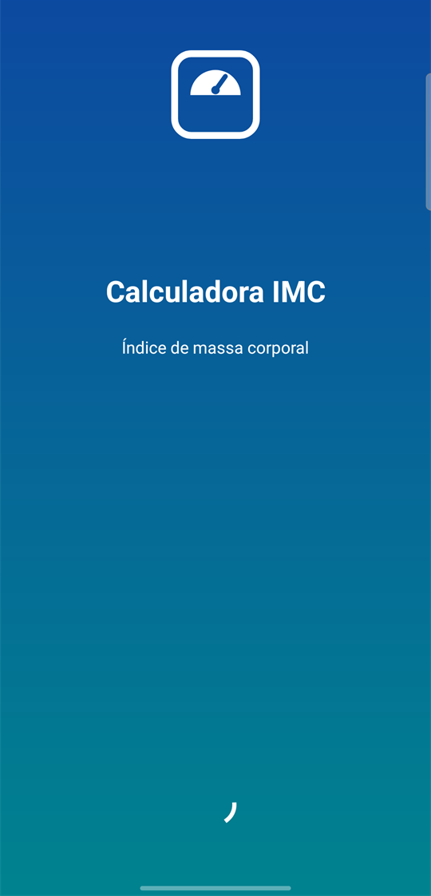
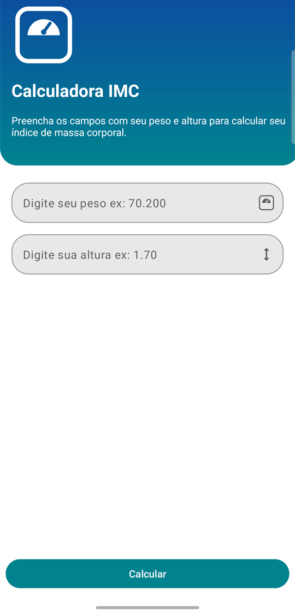
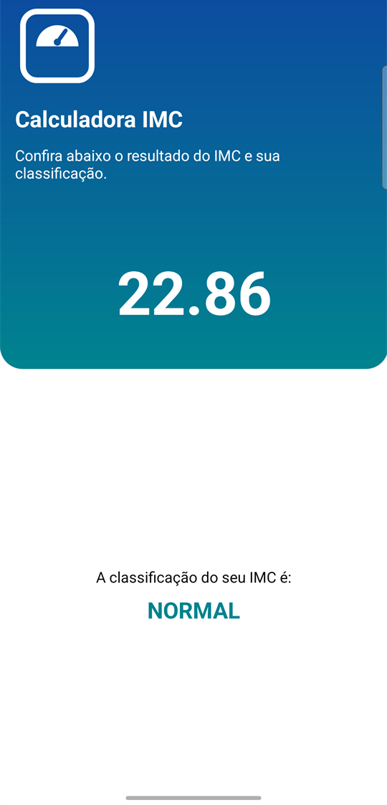

# 📱 Calculadora IMC

Aplicativo Android que calcula o **IMC (Índice de Massa Corporal)** a partir do peso e da altura e mostra a classificação.

Projeto feito para o [Desafio 0 da Escola Nova Era](https://github.com/Escola-Nova-Era/form-android/blob/main/desafio0/README.md), praticando o básico de Android com Kotlin.

## 📸 Telas

| Splash | Dados | Resultado |
|:---:|:---:|:---:|
|  |  |  |

## 🚀 Funcionalidades

- Tela de splash
- Inserir peso e altura
- Aviso quando os campos estão vazios ou inválidos
- Calcular o IMC
- Mostrar o resultado e a classificação
- Navegação entre telas

## 🛠 Tecnologias

- Kotlin
- XML (ConstraintLayout)
- Activity e Intent
- ImageView, TextView e Button
- TextInputLayout e TextInputEditText

## 🧮 Fórmula

```
IMC = peso / (altura × altura)
```

Exemplo: 70 / (1.75 × 1.75) = 22.86

## 📊 Classificação

| IMC | Classificação |
|---|---|
| Menor que 18.5 | Abaixo do peso |
| De 18.5 a menor que 25 | Normal |
| De 25 a menor que 30 | Sobrepeso |
| De 30 a menor que 35 | Obesidade Grau I |
| De 35 a menor que 40 | Obesidade Grau II |
| 40 ou mais | Obesidade Grau III |

## ▶️ Como executar

1. Clone o repositório:
   ```
   git clone https://github.com/Lira95/imc-calculator.git
   ```
2. Abra a pasta no Android Studio.
3. Espere o Gradle sincronizar.
4. Clique em **Run ▶** em um celular ou emulador com **Android 17 (API 37)**.
